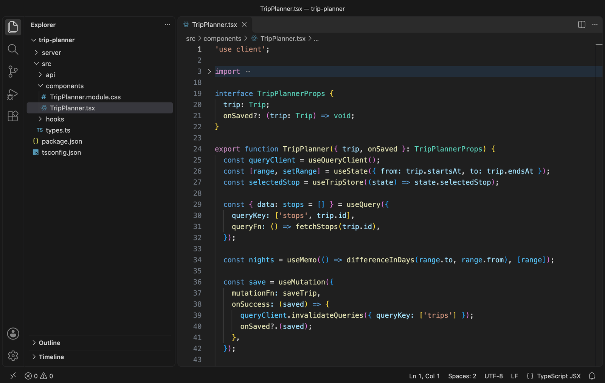
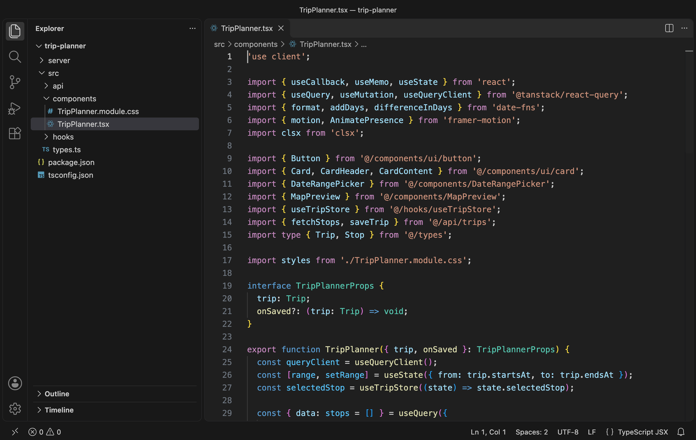
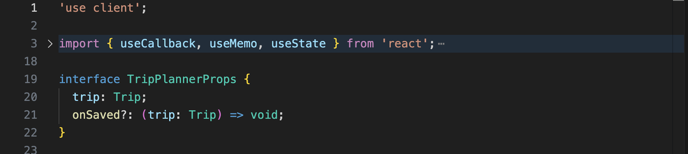

# Tuck Imports

Collapse the import block of your JavaScript and TypeScript files when you open them, the way Android Studio and IntelliJ do. The folded block reads `import ⋯`, so a file starts where its code starts.


## Features

- Folds the import block when a file opens
- Android Studio style folded line: `import ⋯`, with the keyword keeping its syntax color
- One fold for the whole block:
  - multi-line imports, `import type`, side-effect imports, import attributes
  - comments and blank lines between import groups
  - a single multi-line import
- CommonJS `require()` declarations at the top of the file
- Skips shebangs, license headers and directives like `'use client'`
- Vue and Svelte `<script>` blocks, Astro frontmatter
- Unfold once and the block stays open until you close the file

## Folded and expanded





## Commands

| Command                        | ID                   |
| ------------------------------ | -------------------- |
| `Tuck Imports: Fold Imports`   | `tuckImports.fold`   |
| `Tuck Imports: Unfold Imports` | `tuckImports.unfold` |
| `Tuck Imports: Toggle Imports` | `tuckImports.toggle` |

No default keybinding. To add one, open **Preferences: Open Keyboard Shortcuts (JSON)**:

```json
{ "key": "ctrl+alt+i", "command": "tuckImports.toggle", "when": "editorTextFocus" }
```

## Settings

| Setting                      | Default                       | Description                                                    |
| ---------------------------- | ----------------------------- | -------------------------------------------------------------- |
| `tuckImports.autoFold`       | `true`                        | Fold the import block when a file opens                        |
| `tuckImports.compact`        | `true`                        | Show `import ⋯` instead of the first import line               |
| `tuckImports.includeRequire` | `true`                        | Treat top-level `require()` declarations as imports            |
| `tuckImports.minLines`       | `2`                           | Only auto-fold blocks that span at least this many lines       |
| `tuckImports.languages`      | JS, TS, JSX, TSX, Vue, Svelte, Astro | Language IDs to handle                                  |

With `tuckImports.compact` off, the folded line looks like any other VS Code fold:



## Compared to `editor.foldingImportsByDefault`

VS Code has a built-in setting that folds TS/JS imports on open. Tuck Imports adds:

- `import ⋯` instead of the full first import line
- `require()` blocks, Vue, Svelte and Astro
- Fold, unfold and toggle commands
- Folding a block made of a single multi-line import

## Notes

- Clicking `⋯` or moving the cursor into the hidden lines expands the block, like any fold
- Moving the cursor past `import` on the folded line shows the full line again
